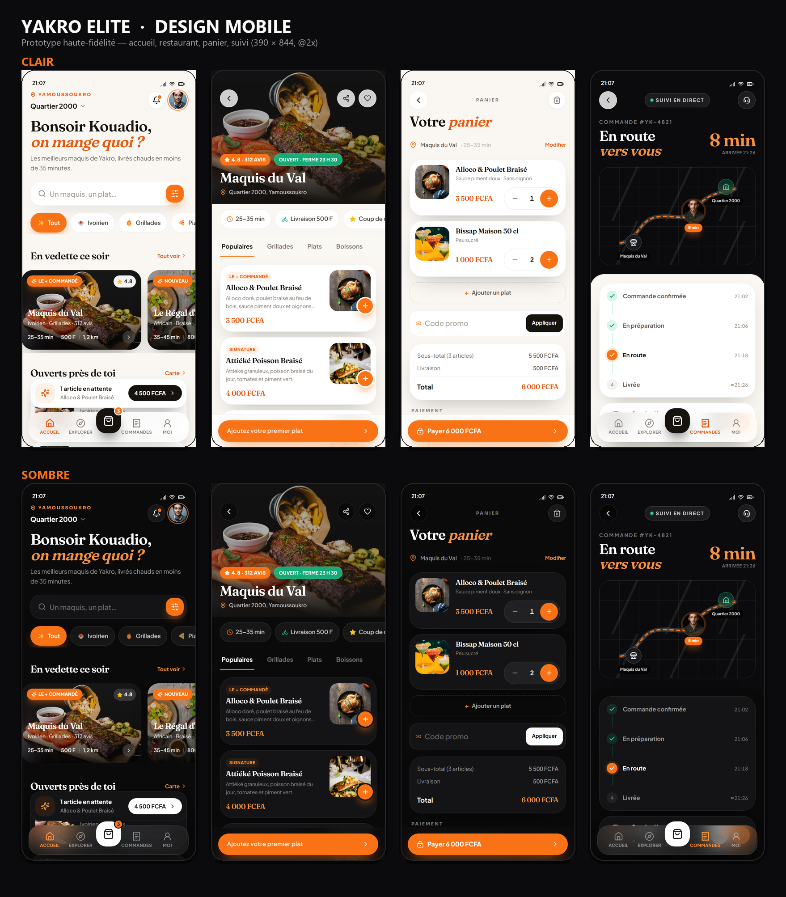

# Yakro Elite — Design mobile « Nuit & Braise »

> Statut : **prototype haute-fidélité validé** (captures clair/sombre, QA responsive 320 → 430 px).
> Objectif : donner à Yakro-Fê une expérience mobile qui a la tenue d'une app de livraison premium,
> sans renier la chaleur ivoirienne du produit.



## 1. Intention

Une app de livraison de repas vit sur trois promesses : **donner faim**, **rassurer**, **aller vite**.
L'interface existante tenait la troisième, moins les deux premières : fond gris froid, micro-textes
à 8–9 px, cartes génériques, chrome (logo centré + 5 onglets) plus présent que le contenu.

La direction « **Nuit & Braise** » inverse le rapport :

- **Chaleur avant le froid** — fond crème `#FAF7F2`, encre chaude `#16130F`, orange braise
  `#F97316`, vert marché `#10B981`. Le mode sombre n'est pas un gris neutre : c'est du noir
  braise `#0A0A0B` avec de la lumière orange.
- **Éditorial avant utilitaire** — les titres sont en Fraunces (déjà chargée), italique pour les
  mots d'envie ; le texte d'interface reste Jakarta Sans. La hiérarchie raconte une histoire :
  « Bonsoir Kouadio, *on mange quoi ?* ».
- **La photo est le produit** — cartes plein cadre, dégradés de lisibilité, images de plats en
  carré arrondi côté liste : on choisit avec les yeux avant de lire une ligne de description.
- **Le contenu avant le chrome** — un dock flottant de 66 px, un seul CTA par écran, des marges
  généreuses ; le panier est un bouton central surélevé, pas une ligne de menu.

## 2. Tokens

| Rôle | Clair | Sombre |
|---|---|---|
| Fond écran | `#FAF7F2` | `#0A0A0B` |
| Surface carte | `#FFFFFF` | `#141416` |
| Encre | `#16130F` | `#FAFAF9` |
| Encre secondaire | `#6B625A` | `rgba(255,255,255,0.55)` |
| Encre tertiaire | `#8A8078` | `rgba(255,255,255,0.45)` |
| Accent | `#F97316` | `#F97316` |
| Accent texte | `#EA580C` | `#FB923C` |
| Succès | `#10B981` | `#34D399` |
| Bordure | `rgba(0,0,0,0.05)` | `rgba(255,255,255,0.07)` |

- **Rayons** : cartes `1.75rem`, images `1.1–1.6rem`, pilules/boutons `full`.
- **Ombres** : chaudes et diffuses (`rgba(22,19,15,…)`), jamais grises-bleues ; ombres orange
  réservées aux CTA et au FAB panier.
- **Typo** : display Fraunces 30–40 px (titres), 16–19 px (cartes), corps Jakarta 11,5–14 px,
  micro-labels Sora 10 px `uppercase tracking-[0.22em]`.
- **Toucher** : cibles ≥ 40 px (mesuré), boutons principaux 48–56 px, `env(safe-area-inset-*)`
  respecté en haut et en bas.

Les classes sont centralisées dans [`src/app/globals.css`](../../../src/app/globals.css)
(bloc `.yk-*`) : `yk-screen`, `yk-card`, `yk-glass`, `yk-chip`, `yk-chip-active`, `yk-label`,
`yk-display`, `yk-italic`, `yk-cta`, `yk-bottom-bar`.

## 3. Écrans

| Écran | Route prototype | Intention |
|---|---|---|
| **Accueil** | `/design/mobile` | Localisation + salutation éditoriale, recherche, catégories, carrousel « En vedette », liste « Ouverts près de toi », barre panier flottante, dock. |
| **Restaurant** | `/design/mobile/restaurant` | Photo plein cadre avec note/ouverture, bandeau infos, onglets collants, plats en lignes avec ajout rapide, CTA panier collé. |
| **Panier** | `/design/mobile/panier` | Lignes avec image, options, quantité ; code promo ; total lisible ; moyens de paiement ; CTA verrouillé « Payer ». |
| **Suivi** | `/design/mobile/suivi` | En-tête sombre « En route vers vous » + ETA, carte stylisée restaurant → domicile, timeline, carte livreur, rappel commande. |

Captures : `prototype/clair/*.png`, `prototype/sombre/*.png`, petits écrans `prototype/320/*.png`.
Avant : `avant/*.png` (écrans publics, seuls accessibles sans compte).

### Ce qui change concrètement par rapport à l'existant

- Micro-textes `9–10 px` → plancher à **11,5 px** pour le corps et **10 px** pour les labels.
- Cartes restaurants : image `h-28` écrasée + 3 badges → **photo plein cadre 178 px** ou vignette
  86 px, dégradé, nom en Fraunces, méta ETA/frais/distance sur une ligne.
- Barre de navigation : 5 liens uniformes → **dock flottant en verre** + FAB panier central
  surélevé avec badge.
- Accueil : logo centré → **localisation + salutation** ; le produit parle avant le chrome.
- Panier : totaux noyés → hiérarchie Sous-total / Livraison / **Total en orange Fraunces** + CTA
  collé avec montant.
- Suivi : statut textuel → **carte de trajet + timeline + carte livreur**.

## 4. Qualité vérifiée

- **Responsive** : 320, 390 et 430 px — aucun débordement horizontal, hauteurs cohérentes.
- **Cibles tactiles** : 0 élément interactif sous 40 px (audit automatisé sur 12 configurations).
- **Images** : aucune image cassée ; le composant `FoodImage` fournit un visuel de marque en
  secours. Photos de démo Unsplash dans le prototype, Cloudinary en production. Les héros
  marketing sont passés en WebP (750 Ko → 102 Ko, 889 Ko → 158 Ko).
- **Sémantique** : boutons réels, `aria-label` sur les icônes, `aria-current` sur le dock,
  `aria-pressed` sur les sélecteurs, focus visible natif.
- **Mouvement** : `prefers-reduced-motion` neutralise les animations décoratives (zoom lent,
  flottement, pulsations).
- **Zoom** : le pinch-zoom est autorisé (WCAG 1.4.4) ; les champs restent à 16 px pour éviter
  l'auto-zoom iOS.
- **Contraste** : les surfaces à texte blanc utilisent `#C2410C` (orange-700, ~5,2:1) et non
  l'orange `#F97316` (~2,8:1) ; les textes d'accent en clair passent en orange-700. L'orange vif
  reste réservé aux icônes et éléments décoratifs.

## 5. Intégration dans l'application réelle

**Fait** (design validé par le client) :

| Surface | Fichiers | État |
|---|---|---|
| Dock flottant + en-tête | `src/components/bottom-nav-bar.tsx`, `src/components/mobile-header.tsx`, `src/components/mobile-ui.tsx` | ✅ intégré |
| Cartes restaurant (3 variantes) + ligne de plat | `src/components/restaurant-card.tsx`, `src/components/menu-item-card.tsx` | ✅ intégré |
| Page restaurant (héros, onglets, plats) | `src/app/restaurants/page.tsx` | ✅ intégré |
| Panier | `src/components/cart-sheet.tsx` | ✅ intégré |
| Accueil (salutation, recherche, catégories, vedettes, liste) | `src/app/page.tsx` | ✅ intégré |
| Suivi de commande (carte sur l'accueil) | `src/components/order-status.tsx` | ✅ intégré |
| Suivi live (page dédiée) | `src/app/orders/track/page.tsx`, `src/components/orders/order-tracking-stepper.tsx`, `src/components/orders/order-items-card.tsx` | ✅ intégré |

Vérification visuelle sans compte : `/design/mobile/composants` rend les **vrais** composants
intégrés avec des données de démonstration (captures dans `integration/`).

Reste à faire : décision produit sur la navigation (Assistant / Pour Vous hors du dock), et
généralisation du contraste AA aux composants hérités hors du périmètre design (boutons shadcn
`bg-primary`, badges orange anciens écrans).

## 6. Voir le prototype

```bash
npm run dev
# puis http://localhost:9005/design/mobile
#            /design/mobile/restaurant
#            /design/mobile/panier
#            /design/mobile/suivi
#            /design/mobile/composants   ← composants réels intégrés
```

Ces routes renvoient `404` en production (`NODE_ENV === 'production'`) : c'est un outil de
validation, pas une page publique.
